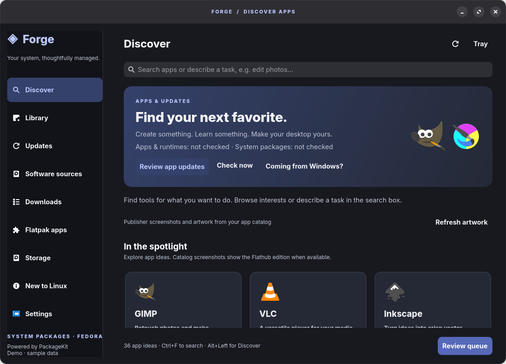

# Forge

A GTK 4/libadwaita app browser, package updater, and storage cleanup tool for Linux. **Preview software**, developed with substantial AI assistance; see [AI disclosure](AI-DISCLOSURE.md).

**[Download Forge 0.15.0 for Linux x86_64](https://github.com/jmlp0818/Forge/releases/download/v0.15.0/Forge-0.15.0.flatpak)** · [Releases and source archives](https://github.com/jmlp0818/Forge/releases) · [Report an issue](https://github.com/jmlp0818/Forge/issues)



## Install

Install Flatpak through your Linux distribution first. Open `Forge-0.15.0.flatpak` with your software installer, or use:

```sh
flatpak install --user ./Forge-0.15.0.flatpak
flatpak run io.github.jmlp0818.Forge
```

The GNOME Platform 51 runtime may be downloaded. Native package actions require a working PackageKit backend. Host Python and Flatpak are checked in **Settings → Check setup**. No Windows, macOS, or ARM build is provided.

### Moving from 0.14.0

0.15.0 corrects the application ID from `io.github.forge.PackageManager` to `io.github.jmlp0818.Forge`, matching this repository's owner. Flatpak treats these as different applications. Quit the old Forge before launching the new one. Disable the old app's login startup if enabled, then optionally remove the old app using your software installer. Do not delete its data unless you intentionally want to discard it. This release does not migrate preferences or enable startup automatically. Do not run both versions for package changes at the same time.

## What it does

- Browse app suggestions and search configured native repositories.
- Review native package changes and Flatpak app/runtime updates.
- Keep update selections in a shared Downloads view.
- Check for updates while running, with optional desktop notifications/background behavior.
- Preview cache, old log, crash-report, and Trash cleanup before applying selections.
- Choose appearance, login startup, and dock/tray behavior.

Updates and cleanup require review; nothing installs or cleans automatically. Tray support depends on the desktop. Screenshots use demo data.

## Permissions and limits

Forge uses broad host-command access for Flatpak management, setup, catalog artwork, and cleanup, plus PackageKit access for native packages. The Flatpak is **not a strict isolation boundary**. System changes use the desktop's administrator authentication. Cleanup can permanently delete selected files. Rollback is not implemented.

Automated tests cover safety rules and simulated transaction failures. Disposable Flatpak fixtures exercise real local install/update/remove flows. These checks do not establish safe native package upgrades on every distribution. Full Ubuntu/Arch desktop operations, power-loss recovery, actual login startup, and broad real-world use remain unverified. See [validation](docs/VALIDATION.md).

## Updating Forge itself

Check [Releases](https://github.com/jmlp0818/Forge/releases) and install a newer bundle with the same application ID. GitHub distribution does not configure a signed Flatpak repository or automatic updates for Forge. Release checksums verify file consistency; they are not publisher signatures. Bundles are currently unsigned. See [release procedure](docs/RELEASING.md).

## Build from source

For the Python-only GitHub build, install GNOME Platform 51 and Flatpak first, then:

```sh
python3 packaging.py build ../forge-release
```

This creates an installer, deterministic source archive, build information, checksums, and an archive/checksum-pinned **GitHub build manifest**. It does not install the resulting app. The build records the installed runtime commit; matching source and runtime inputs are required when comparing builds. Bit-for-bit installer reproducibility across hosts is not claimed.

For flatpak-builder development builds, install the GNOME SDK 51 and run:

```sh
flatpak-builder --user --force-clean --repo=repo build io.github.jmlp0818.Forge.json
```

The root manifest uses this local source tree. `Forge-GitHub-build.json` in each release points at the exact source archive and SHA-256. Both are AI-assisted **GitHub packaging**, not Flathub submission manifests.

## Tests and support

Source tests require Python 3, PyGObject, GTK 4 and libadwaita:

```sh
python3 -m unittest discover -s tests -v
```

Use a graphical session, or `xvfb-run -a` for headless tests. See [contributing](CONTRIBUTING.md) and [security](SECURITY.md). Include your distribution, desktop, Forge version, installation scope, and reproduction steps in reports. Remove passwords, tokens, personal filenames, and other private data.

## Distribution status

Published on GitHub only. No Flathub acceptance or affiliation is claimed. Current Flathub policies raise host-utility, host-dependency, development-history, and AI-packaging restrictions; see [distribution status](docs/DISTRIBUTION.md).

Code is MIT licensed. AppStream metadata is CC0-1.0. Third-party names and artwork retain their owners' rights; see [artwork notices](data/app-icons/ICONS.md).
